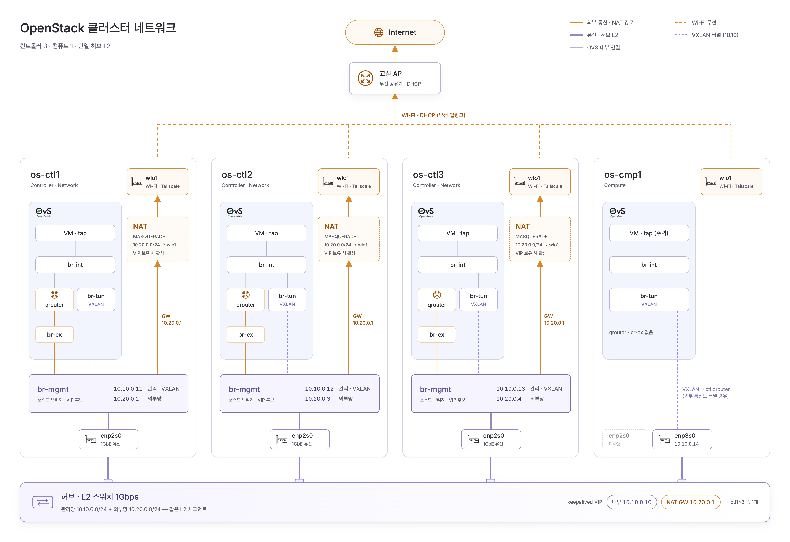

<p align="center">
  
</p>

# DangUBI Host Network

OpenStack(kolla-ansible) 멀티노드 배포 전에 필요한 **호스트 네트워크 상태를 Ansible로 점검**하는 저장소입니다.
노트북 3대(컨트롤러)와 PC 1대(컴퓨트)로 구성된 클러스터를 대상으로 합니다.

## 1. 멀티노드 네트워크 구조

### 노드 구성

| 호스트 | 그룹 | 장비 | 관리망 IP (`mgmt_ip`) | 외부망 IP (`ext_ip`) | 망이 붙는 인터페이스 (`mgmt_if`) |
|---|---|---|---|---|---|
| os-ctl1 | controllers | 노트북 | 10.10.0.11 | 10.20.0.2 | `br-mgmt` (브리지) |
| os-ctl2 | controllers | 노트북 | 10.10.0.12 | 10.20.0.3 | `br-mgmt` (브리지) |
| os-ctl3 | controllers | 노트북 | 10.10.0.13 | 10.20.0.4 | `br-mgmt` (브리지) |
| os-cmp1 | computes | PC | 10.10.0.14 | 10.20.0.5 | `enp3s0` (물리 NIC) |

SSH 접속 주소(`ansible_host`)와 계정(`ansible_user`)은 커밋하지 않고 각자 로컬의 `ansible/inventory/hosts.yml`에 둡니다. 저장소에는 템플릿 [`hosts.example.yml`](ansible/inventory/hosts.example.yml)만 있습니다.

### 네트워크

| 네트워크 | 대역 | 용도 |
|---|---|---|
| 업링크 | `wlo1` (Wi-Fi) | 인터넷으로 나가는 기본 경로 |
| 관리망 | `10.10.0.0/24` | kolla 관리망. 노드 간 API·DB·메시지 큐 통신 |
| 외부망 | `10.20.0.0/24` | Neutron 외부망. VM의 floating IP 대역 |
| 내부 VIP | `10.10.0.10` | 관리망 VIP (keepalived). 컨트롤러 중 한 대가 보유 |
| NAT VIP | `10.20.0.1` | 외부망의 게이트웨이 (keepalived). 컨트롤러 중 한 대가 보유 |
| Ansible 제어 | Tailscale (`100.x.x.x`) | 작업자 PC에서 각 노드로 SSH 접속 |



### 핵심 포인트

- **모든 노드는 1Gbps 허브·L2 스위치 하나로 연결됩니다.** 관리망과 외부망이 같은 L2 세그먼트를 공유합니다.
- **관리망과 외부망은 같은 인터페이스를 씁니다.** 컨트롤러는 유선 NIC `enp2s0`을 포트로 둔 `br-mgmt` 브리지에, 컴퓨트는 `enp3s0`에 두 대역의 IP가 함께 붙습니다.
- **컨트롤러의 veth pair.** `veth-host`는 `br-mgmt`에 포트로 꽂히고, 반대쪽 `veth-neutron`은 Neutron이 외부 인터페이스로 가져갑니다. 이 pair는 `veth-neutron.service`(systemd)가 부팅할 때 만들고, NetworkManager는 두 인터페이스를 관리하지 않도록(`unmanaged`) 설정합니다.
- **외부망은 NAT으로 인터넷에 나갑니다.** 컨트롤러는 IP 포워딩을 켜고, `10.20.0.0/24`에서 나가는 트래픽을 `wlo1`로 MASQUERADE합니다. 규칙은 `/etc/iptables/rules.v4`에 저장해서 재부팅 뒤에도 유지됩니다.
- **NAT VIP `10.20.0.1`**은 외부망의 기본 게이트웨이입니다. keepalived가 컨트롤러 3대 중 한 대에 VIP를 올리고, VIP를 가진 노드에서만 NAT 경로가 실제로 쓰입니다.
- **컴퓨트 노드에는 qrouter와 br-ex가 없습니다.** VM 트래픽은 VXLAN 터널(관리망)을 타고 컨트롤러의 qrouter로 가서 외부로 나갑니다.

## 2. 폴더 구조

```
.
├── README.md
├── .gitignore                      # hosts.yml, vault 비밀번호 파일 제외
├── .claude/skills/
│   ├── readme-sync/                # Claude Code 스킬: 푸시 전에 변경 사항을 README에 반영
│   └── git-workflow/               # Claude Code 스킬: develop 파생 브랜치 → 작은 커밋 → PR → Codex 리뷰 검토
├── docs/images/                    # README 이미지
└── ansible/
    ├── ansible.cfg                 # 인벤토리·roles 경로, sudo, SSH 설정
    ├── inventory/
    │   ├── hosts.example.yml       # 인벤토리 템플릿 (controllers / computes 그룹, 호스트별 IP)
    │   ├── hosts.yml               # 실제 인벤토리. 템플릿을 복사해 만듦 (커밋 제외)
    │   └── group_vars/
    │       ├── all.yml             # 공통: uplink_if, ext_cidr, nat_vip, net_prefix, mgmt_cidr
    │       ├── controllers.yml     # mgmt_if: br-mgmt, 덮개 절전 무시·IP 포워딩 켬
    │       └── computes.yml        # mgmt_if: enp3s0, 덮개·포워딩 관리 안 함
    ├── playbooks/
    │   ├── base.yml                # 호스트 기본 설정 적용 (base role)
    │   └── verify.yml              # 네트워크·기본 설정 상태 점검 (읽기 전용)
    └── roles/
        ├── base/                   # 호스트 기본 설정 (현재 수동 구성 상태를 코드로 표현)
        │   ├── README.md           # 항목별 설명, 변수, 하지 않는 것과 이유
        │   ├── defaults/main.yml   # 기본 변수 (절전 target, chrony 파일 내용·켜기 여부 등)
        │   ├── handlers/main.yml   # chrony reload/restart (logind 재시작 handler 없음)
        │   └── tasks/
        │       ├── main.yml        # 아래 파일을 순서대로 import
        │       ├── hostname.yml    # 호스트명 = inventory_hostname 확인 (다르면 실패)
        │       ├── hosts_file.yml  # /etc/hosts: 127.0.1.1 제거, 누락된 mgmt_ip 매핑만 추가
        │       ├── power.yml       # 절전 target mask, 컨트롤러 덮개 절전 무시 drop-in
        │       ├── firewall.yml    # ufw 비활성 (미설치 노드는 건너뜀)
        │       ├── sysctl.yml      # 컨트롤러: net.ipv4.ip_forward=1 (99-forward.conf)
        │       └── chrony.yml      # chrony 설치·실행, NTP 소스 파일
        ├── verify_base/tasks/      # base 설정 점검: 호스트명·이름 해석, 절전, ufw, 포워딩 파일, chrony 동기화
        └── verify_network/tasks/
            ├── main.yml            # 점검 순서. 컨트롤러 전용 항목은 group_names로 선택
            ├── route.yml           # 전체: 기본 경로가 uplink_if인지
            ├── mgmt_addr.yml       # 전체: mgmt_if에 관리망·외부망 IP가 있는지
            ├── veth.yml            # 컨트롤러: veth pair, systemd 서비스, NetworkManager
            └── nat.yml             # 컨트롤러: NAT VIP, IP 포워딩, MASQUERADE
```

점검 태스크는 `조회(get) → 판정(assert)` 쌍으로 되어 있고, 이름도 `<대상> | get …`, `<대상> | assert …` 형식으로 맞췄습니다.

## 3. Ansible 명령어

모든 명령은 **`ansible/` 디렉터리에서** 실행합니다. `ansible.cfg`가 이 디렉터리에 있어서, 다른 곳에서 실행하면 인벤토리와 role을 찾지 못합니다.

```bash
cd ansible
```

### 실행 전 준비

1. 인벤토리 템플릿을 복사하고 `<tailscale-ip>`, `<ssh-user>`를 실제 값으로 채웁니다.
   ```bash
   cp inventory/hosts.example.yml inventory/hosts.yml
   ```
2. 작업자 PC와 모든 노드가 Tailscale에 연결되어 있어야 합니다.
3. 각 노드 계정에 SSH 키로 로그인할 수 있어야 합니다. (`ssh-copy-id <user>@<ansible_host>`)
4. `host_key_checking = True`이므로 각 노드에 한 번 `ssh`로 접속해 known_hosts에 등록합니다.
5. 실행하면 처음에 `BECOME password:`(sudo 비밀번호)를 한 번 묻습니다. 이 값을 모든 노드에 똑같이 사용합니다.

### 인벤토리 확인

```bash
ansible-inventory --graph                 # 그룹과 호스트 트리
ansible-inventory --graph --vars          # 호스트별 변수까지
ansible-inventory --host os-ctl1          # 특정 호스트에 적용되는 변수
ansible all -m ping                       # 모든 노드 SSH·Python 연결 확인
```

### 호스트 기본 설정 (base)

이미 손으로 구성된 노드의 상태를 코드로 옮긴 것이라, **check 결과가 `changed=0`이어야 정상**입니다. 변경이 나오면 적용하지 말고 diff를 먼저 확인합니다.

```bash
ansible-playbook playbooks/base.yml --check --diff --limit os-ctl2   # VIP 없는 노드부터 미리보기
ansible-playbook playbooks/base.yml --check --diff                   # 전체 미리보기
ansible-playbook playbooks/base.yml                                  # 적용
```

- 호스트명이 인벤토리와 다르면 실패만 합니다. 실제 변경은 `-e base_allow_hostname_change=true`일 때만 합니다. (Kolla 배포 후 변경 위험)
- 덮개 설정 drop-in이 바뀌어도 `systemd-logind`는 재시작하지 않습니다. 재부팅해야 적용됩니다.

### 점검 (verify)

```bash
ansible-playbook playbooks/verify.yml                         # 전체 노드 점검
ansible-playbook playbooks/verify.yml --limit controllers     # 컨트롤러만
ansible-playbook playbooks/verify.yml --limit os-cmp1         # 특정 호스트만
ansible-playbook playbooks/verify.yml -v                      # 명령 출력까지 자세히
```

### 실행 전 검사

```bash
ansible-playbook playbooks/verify.yml --syntax-check          # 문법 검사
ansible-playbook playbooks/verify.yml --list-tasks            # 실행할 태스크 목록
ansible-playbook playbooks/verify.yml --list-hosts            # 대상 호스트 목록
```

### 결과 읽기

- `ok`는 통과, `failed`는 실패, `skipping`은 대상이 아니라서 건너뛴 태스크입니다.
- 실패하면 assert의 `fail_msg`에 실제 값이 출력됩니다. (예: `net.ipv4.ip_forward = 0`)
- 마지막 `PLAY RECAP`에서 호스트별로 `failed=0`인지 확인합니다.
- 하나라도 실패하면 종료 코드가 0이 아니므로 스크립트에서 `&&`로 이어 쓸 수 있습니다.
- 실패한 호스트는 그 지점에서 점검이 멈춥니다. 원인을 고친 뒤 다시 실행합니다.

`verify.yml`은 조회만 하고 시스템을 바꾸지 않으므로 언제 실행해도 안전합니다. 네트워크 설정을 바꾼 직후, 노드를 재부팅한 뒤, kolla-ansible 배포 전에 실행하는 것을 권장합니다.
